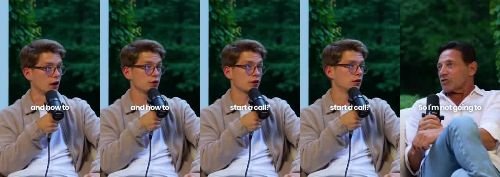

# v13_s14 · aroll_caption · 20.4–21.4s (calidad 3)

- **Guion:** And how do you start a call?
- **Qué se ve:** [observado 20.33–21.4] entrevistador pregunta: 'start a call?'.
- **Diseño:** 1 línea blanca.
- **Efectos:** Ninguno.
- **Animación:** Cortes secos.
- **Por qué aquí:** [inferido] Pregunta-capítulo: abre el segundo bloque.
