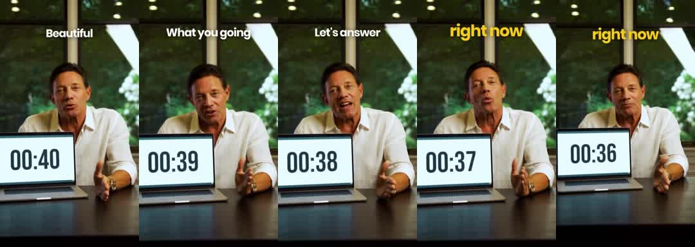

# v14_s11 · aroll_caption · 17.1–20.8s (calidad 2)

- **Guion:** Beautiful. What's she going to ask? Let's answer it together right now.
- **Qué se ve:** [observado 17.2–20.4] 'Beautiful' / 'What you going' / 'to ask?' / 'Let's answer' / 'it together' / 'right now' (amarillo).
- **Diseño:** Blanco arriba y≈12 %; 'right now' amarillo al mismo tamaño.
- **Efectos:** Ninguno.
- **Animación:** Bloques secos.
- **Por qué aquí:** [inferido] Respuesta rápida; 'right now' = urgencia en amarillo.
