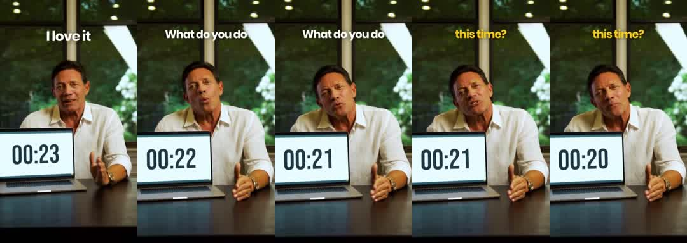

# v14_s19 · aroll_caption · 31.2–33.6s (calidad 2)

- **Guion:** I love it. What do you do differently this time?
- **Qué se ve:** [observado 31.2–33.2] 'I love it' / 'What do you do' / 'differently' / 'this time?' amarillo.
- **Diseño:** Blanco arriba; 'this time?' amarillo mismo tamaño.
- **Efectos:** Ninguno.
- **Animación:** Bloques secos.
- **Por qué aquí:** [inferido] Respuesta con pregunta.
