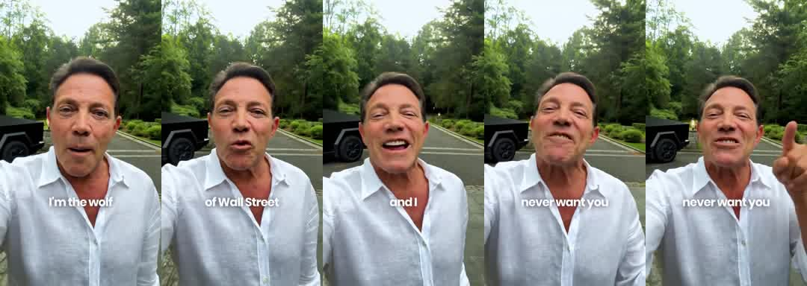

# v15_s01 · aroll_caption · 0.0–2.2s (calidad 3)

- **Guion:** I'm the Wolf of Wall Street and I never want you to
- **Qué se ve:** [observado 0.0–1.5] presentación 'I'm the wolf' / 'of Wall Street' / 'and I' / 'never want you'. Selfie con celular en exterior (entrada de una casa con árboles, coches negros aparcados); Jordan con camisa blanca de lino, brazo extendido sujetando el teléfono, plano medio-corto con gran angular.
- **Diseño:** Subtítulo: 1 línea blanca extra-bold tipo Poppins, minúsculas, ~3 % alto, ~40–70 % ancho, centro y≈70 % (pecho bajo), sombra suave; sin amarillo; cambio seco por bloque.
- **Efectos:** Grado natural del móvil, cielo casi quemado, verdes; sin textura ni viñeta añadida.
- **Animación:** Corte seco al frame 0, sin zoom.
- **Por qué aquí:** [inferido] Hook de identidad: el apodo-marca en la primera frase, cara a cámara.
