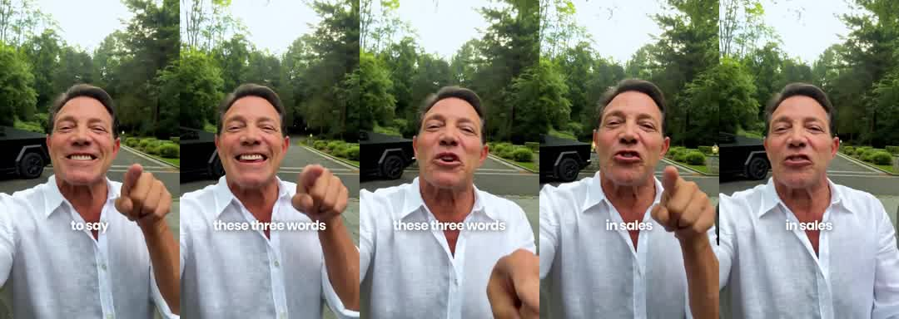

# v15_s02 · aroll_caption · 2.2–4.6s (calidad 3)

- **Guion:** say these three words in sales.
- **Qué se ve:** [observado 1.5–4.4] señala a cámara con el índice; 'to say' / 'these three words' / 'in sales'. Selfie con celular en exterior (entrada de una casa con árboles, coches negros aparcados); Jordan con camisa blanca de lino, brazo extendido sujetando el teléfono, plano medio-corto con gran angular.
- **Diseño:** Subtítulo: 1 línea blanca extra-bold tipo Poppins, minúsculas, ~3 % alto, ~40–70 % ancho, centro y≈70 % (pecho bajo), sombra suave; sin amarillo; cambio seco por bloque.
- **Efectos:** Grado natural del móvil, cielo casi quemado, verdes; sin textura ni viñeta añadida.
- **Animación:** Bloques secos.
- **Por qué aquí:** [inferido] Promesa de lista (3 palabras) = retención.
