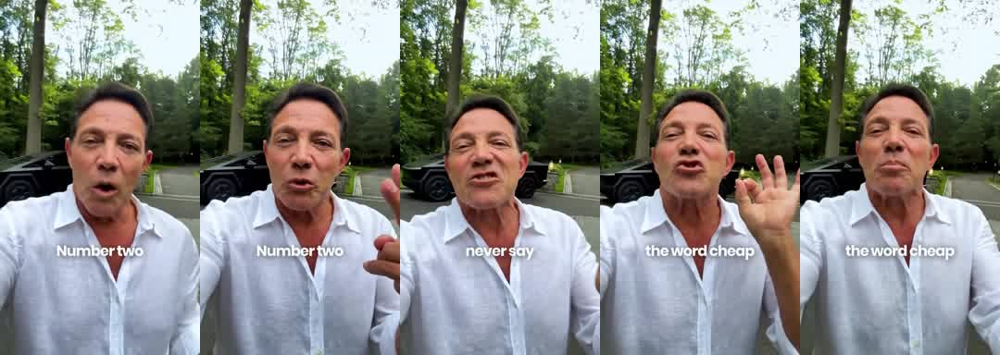

# v15_s10 · aroll_caption · 19.7–21.7s (calidad 2)

- **Guion:** Number two, never say the word cheap.
- **Qué se ve:** [observado 19.7–21.6] 'Number two' / 'never say' / 'the word cheap'. La numeración SOLO aparece como subtítulo blanco normal (sin número gráfico). Selfie con celular en exterior (entrada de una casa con árboles, coches negros aparcados); Jordan con camisa blanca de lino, brazo extendido sujetando el teléfono, plano medio-corto con gran angular.
- **Diseño:** Subtítulo: 1 línea blanca extra-bold tipo Poppins, minúsculas, ~3 % alto, ~40–70 % ancho, centro y≈70 % (pecho bajo), sombra suave; sin amarillo; cambio seco por bloque.
- **Efectos:** Grado natural del móvil, cielo casi quemado, verdes; sin textura ni viñeta añadida.
- **Animación:** [observado 19.7] corte seco desde película; jump-cut 20.4. Bloques de subtítulo secos.
- **Por qué aquí:** [inferido] Cambio de punto marcado solo con la voz y el caption.
