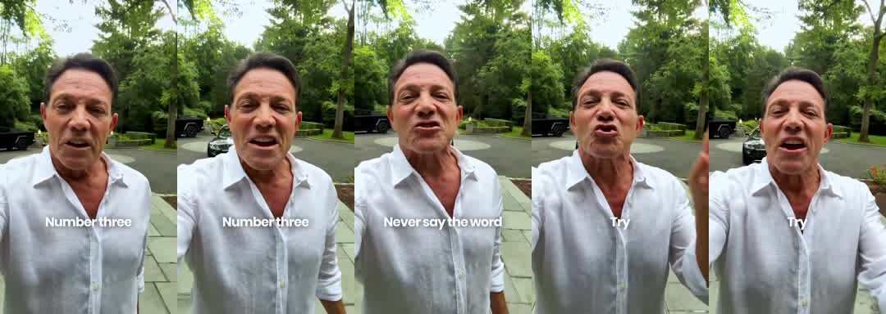

# v15_s18 · aroll_caption · 34.6–37.1s (calidad 2)

- **Guion:** Number three, never say the word try.
- **Qué se ve:** [observado 34.6–36.9] 'Number three' / 'Never say the word' / 'Try'. Fondo cambia: ahora pavimento y coche negro al fondo (otra toma). Selfie con celular en exterior (entrada de una casa con árboles, coches negros aparcados); Jordan con camisa blanca de lino, brazo extendido sujetando el teléfono, plano medio-corto con gran angular.
- **Diseño:** Subtítulo: 1 línea blanca extra-bold tipo Poppins, minúsculas, ~3 % alto, ~40–70 % ancho, centro y≈70 % (pecho bajo), sombra suave; sin amarillo; cambio seco por bloque.
- **Efectos:** Grado natural del móvil, cielo casi quemado, verdes; sin textura ni viñeta añadida.
- **Animación:** [observado 34.633] corte seco desde película. Bloques de subtítulo secos.
- **Por qué aquí:** [inferido] Punto 3, solo con voz/caption.
