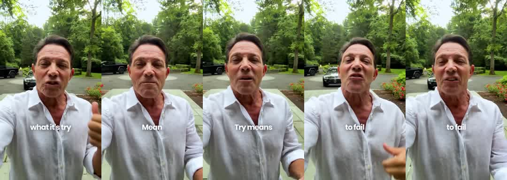

# v15_s20 · aroll_caption · 39.1–41.9s (calidad 2)

- **Guion:** What does try mean? Try means you're gonna fail.
- **Qué se ve:** [observado 39.1–41.8] 'what it's try' / 'Mean' / 'Try means' / 'you're going' / 'to fail'. Selfie con celular en exterior (entrada de una casa con árboles, coches negros aparcados); Jordan con camisa blanca de lino, brazo extendido sujetando el teléfono, plano medio-corto con gran angular.
- **Diseño:** Subtítulo: 1 línea blanca extra-bold tipo Poppins, minúsculas, ~3 % alto, ~40–70 % ancho, centro y≈70 % (pecho bajo), sombra suave; sin amarillo; cambio seco por bloque.
- **Efectos:** Grado natural del móvil, cielo casi quemado, verdes; sin textura ni viñeta añadida.
- **Animación:** [observado 39.13, 40.23] jump-cuts. Bloques de subtítulo secos.
- **Por qué aquí:** [inferido] Explicación.
