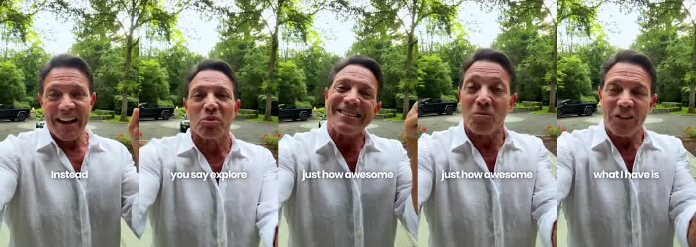

# v15_s22 · aroll_caption · 44.5–49.0s (calidad 2)

- **Guion:** Instead, you say explore and you get to see just how awesome what I have is.
- **Qué se ve:** [observado 44.5–48.8] 'Instead' / 'you say explore' / 'and you get to see' / 'just how awesome' / 'what I have is'. Selfie con celular en exterior (entrada de una casa con árboles, coches negros aparcados); Jordan con camisa blanca de lino, brazo extendido sujetando el teléfono, plano medio-corto con gran angular.
- **Diseño:** Subtítulo: 1 línea blanca extra-bold tipo Poppins, minúsculas, ~3 % alto, ~40–70 % ancho, centro y≈70 % (pecho bajo), sombra suave; sin amarillo; cambio seco por bloque.
- **Efectos:** Grado natural del móvil, cielo casi quemado, verdes; sin textura ni viñeta añadida.
- **Animación:** [observado 44.5, 48.1] jump-cuts. Bloques de subtítulo secos.
- **Por qué aquí:** [inferido] Beneficio de la alternativa.
