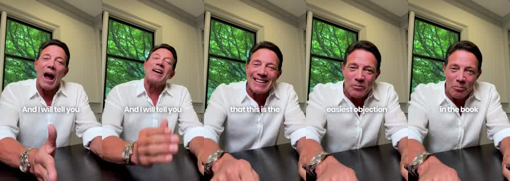

# v16_s04 · aroll_caption · 6.3–10.7s (calidad 2)

- **Guion:** and I will tell you that this is the easiest objection in the book.
- **Qué se ve:** [observed 6.24–10.7] Vuelta al A-roll; subtítulos 'And I will tell you', 'that this is the', 'easiest objection', 'in the book'.
- **Diseño:** Subtítulo blanco bold, y≈60 %.
- **Efectos:** Ninguno.
- **Animación:** Cambio duro de subtítulo por frase (≈1–1.5 s cada uno).
- **Por qué aquí:** [inferred] Promesa: la objeción es 'la más fácil' → retención.
