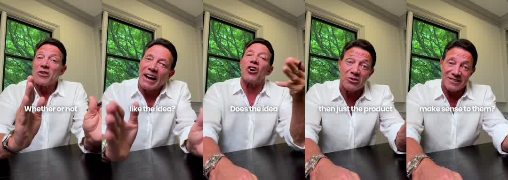

# v16_s09 · aroll_caption · 22.5–27.8s (calidad 2)

- **Guion:** whether or not they actually like the idea? Does the idea make sense to them? Does the product make sense to them?
- **Qué se ve:** [observed 22.53] Jump cut en 'whether'; subtítulos 'Whether or not' (W mayúscula), 'they actually', 'Does the idea', 'then just the product', 'make sense to them?'.
- **Diseño:** Igual.
- **Efectos:** Ninguno.
- **Animación:** Jump cut seco a 22.53.
- **Por qué aquí:** [inferred] Enumeración de preguntas de diagnóstico, se apoya solo en voz y gesto.
