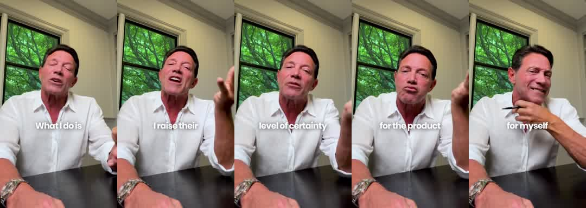

# v16_s10 · aroll_caption · 27.8–31.7s (calidad 2)

- **Guion:** What I do is I raise their level of certainty for the product, for myself,
- **Qué se ve:** [observed] A-roll, 'I raise their', 'for the product', 'for myself' (gesticula con bolígrafo).
- **Diseño:** Igual.
- **Efectos:** Ninguno.
- **Animación:** Cambio duro por frase.
- **Por qué aquí:** [inferred] Solución (los 3 niveles de certeza) en A-roll: anuncia → cara.
