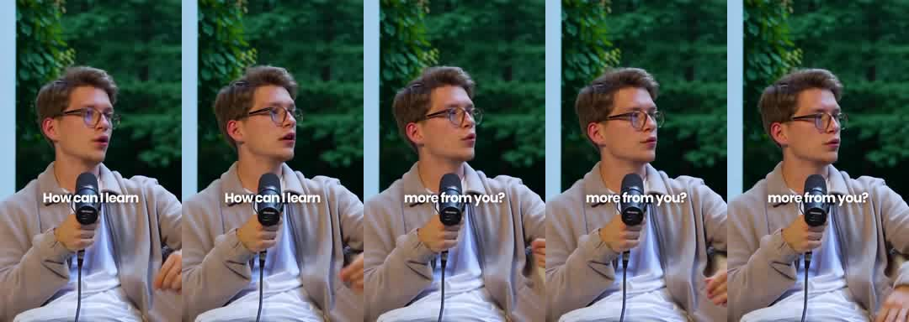

# v17_s19 · aroll_caption · 39.0–40.0s (calidad 3)

- **Guion:** How can I learn more from you?
- **Qué se ve:** [observed 39.03–40.1] Entrevistador pregunta 'How can I learn', 'more from you?'.
- **Diseño:** Blanco bold.
- **Efectos:** Ninguno.
- **Animación:** Corte seco.
- **Por qué aquí:** [inferred] Pregunta guionizada que da pie al CTA.
