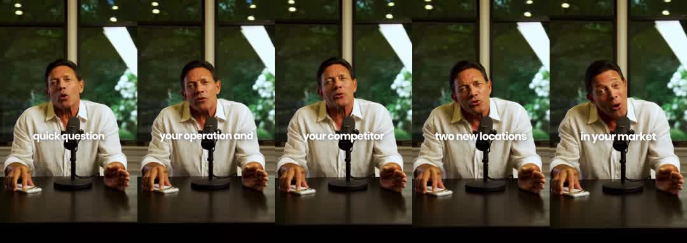

# v18_s13 · aroll_caption · 26.5–33.0s (calidad 2)

- **Guion:** Hey, John, quick question. I was looking at your operation and I'm calling about your competitor. You want to just open two new locations in your market?
- **Qué se ve:** [observed] A-roll role-play del buen opener; 'I was looking at', 'I'm calling about', 'Well', 'two new locations', 'in your market'.
- **Diseño:** Blanco bold.
- **Efectos:** Igual.
- **Animación:** Reemplazo duro.
- **Por qué aquí:** [inferred] Ejemplo largo en cara: el guion es el protagonista.
