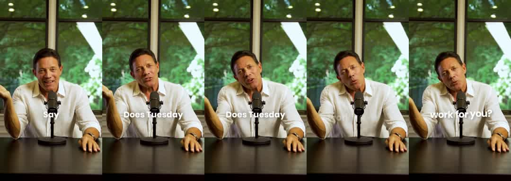

# v20_s07 · aroll_caption · 16.0–18.3s (calidad 2)

- **Guion:** Say, does Tuesday or Thursday work for you?
- **Qué se ve:** [observed] 'or Thursday', 'work for you?'.
- **Diseño:** Blanco bold no itálica ≈3 %, y≈61 %.
- **Efectos:** Ninguno.
- **Animación:** Reemplazo duro.
- **Por qué aquí:** [inferred] La alternativa correcta sin adorno.
