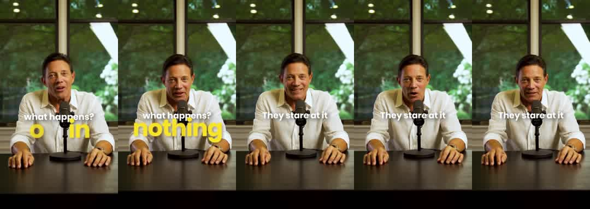

# v05_s03 · aroll_caption_big · 5.1–6.8s (calidad 5)

- **Guion:** Nothing. They stare at it.
- **Qué se ve:** Bajo 'what happens?' (blanco pequeño) aparece 'nothing' AMARILLO grande letra a letra; luego 'They stare at it'. (observado 5.1–6.0)
- **Diseño:** Línea 1 blanca bold ~3 % del alto a ~55 %; línea 2 'nothing' amarillo #F2D10F aprox, sans geométrica extra-bold, ~6 % del alto (≈2× la blanca), en MINÚSCULAS, a ~60 % del alto, ancho ~45 %.
- **Efectos:** Sombra suave.
- **Animación:** Jump cut/punch-out a 5.05; 'nothing' se escribe con letras que aparecen desordenadas (g → in → n thi → nothing) en ~0.4 s (5.1–5.5), luego estable ~0.5 s.
- **Por qué aquí:** Énfasis: la respuesta-remate de una palabra en amarillo grande (inferido).
