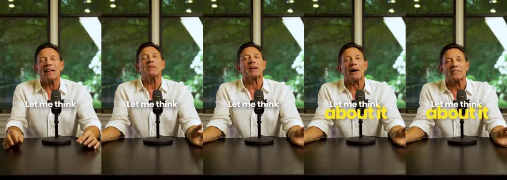

# v05_s07 · aroll_caption_big · 13.3–14.6s (calidad 5)

- **Guion:** let me think about it.
- **Qué se ve:** Punch-in (13.35) y 'Let me think' blanco + 'about it' AMARILLO grande debajo. (observado 13.33–14.5)
- **Diseño:** Blanca ~3 % a ~55 %; amarilla ~6 % a ~60 %, minúsculas, extra-bold.
- **Efectos:** Sombra suave.
- **Animación:** Punch-in por corte a 13.35 (~1.0→1.1, derivado); 'about it' entra ~14.0 con la palabra; punch-out por corte a 14.72.
- **Por qué aquí:** Énfasis en la objeción temida 'let me think about it' (inferido).
