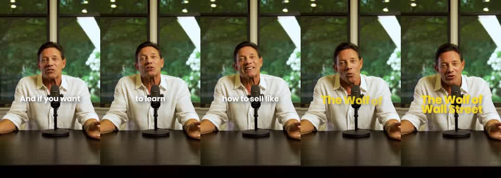

# v05_s19 · aroll_caption_big · 49.6–51.9s (calidad 4)

- **Guion:** And if you wanna learn how to select a Wolf of Wall Street,
- **Qué se ve:** Punch-in (49.59); 'to learn' / 'how to sell like' blanco → 'The Wolf of / Wall Street' AMARILLO en dos líneas, palabra a palabra. (observado 50.4–52.0)
- **Diseño:** Amarillo extra-bold ~5 % del alto, 2 líneas, a ~55–62 %, Title Case (no mayúsculas sostenidas).
- **Efectos:** Sombra suave.
- **Animación:** Punch-in por corte 49.59; 'The' → 'The Wolf' → 'The Wolf of' → 'Wall Street' write-on por palabra con fade gris→amarillo (51.0–51.6).
- **Por qué aquí:** Marca personal resaltada en amarillo antes del CTA (inferido).
