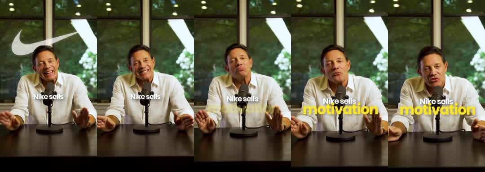

# v07_s02 · aroll_caption_big · 1.8–3.4s (calidad 5)

- **Guion:** Nike sells motivation.
- **Qué se ve:** 'Nike sells motivation.' — palabra 'motivation' grande amarilla bajo 'Nike sells'.
- **Diseño:** Fondo de estudio: mesa negra brillante, micrófono de podcast negro en primer plano centrado, ventanal con columnas y vegetación verde desenfocada detrás (no croma). Subtítulos centrados sobre el pecho/micrófono.
- **Efectos:** Grade cálido-verdoso natural, piel cálida, negros profundos en la mesa; bajo el A-roll queda a veces una franja negra inferior (≈5–9 % del alto) cuando el plano está más abierto (observed 3.7, 37.5); sin grano ni viñeta añadida.
- **Animación:** Punch (corte de encuadre) en 1.71; 'motivation' fade+blur-in 2.58→2.78 (a 'motivation' 2.54).
- **Por qué aquí:** Énfasis: el concepto que de verdad vende la marca va en amarillo.
