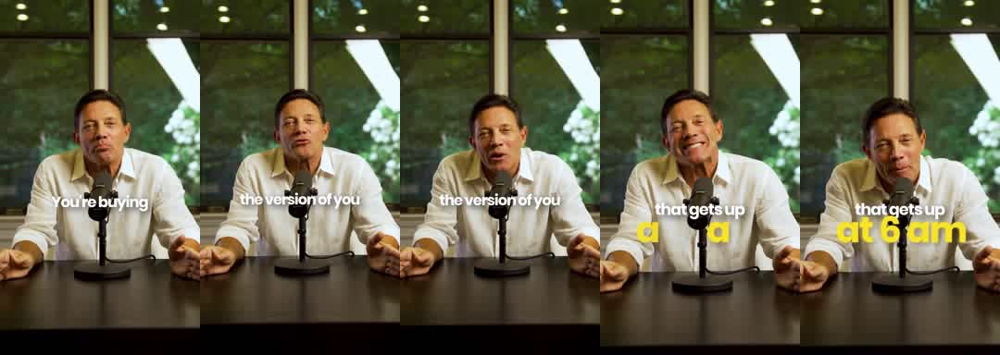

# v07_s04 · aroll_caption_big · 5.3–8.6s (calidad 4)

- **Guion:** You're buying the version of you that gets up at 6 a .m.
- **Qué se ve:** 'You're buying the version of you that gets up at 6 a.m.' — 'at 6 am' amarillo grande.
- **Diseño:** Fondo de estudio: mesa negra brillante, micrófono de podcast negro en primer plano centrado, ventanal con columnas y vegetación verde desenfocada detrás (no croma). Subtítulos centrados sobre el pecho/micrófono.
- **Efectos:** Grade cálido-verdoso natural, piel cálida, negros profundos en la mesa; bajo el A-roll queda a veces una franja negra inferior (≈5–9 % del alto) cuando el plano está más abierto (observed 3.7, 37.5); sin grano ni viñeta añadida.
- **Animación:** Corte de encuadre 5.26; 'at 6 am' entra a ~7.7 s.
- **Por qué aquí:** Dato concreto e imagen mental (madrugar) → amarillo.
