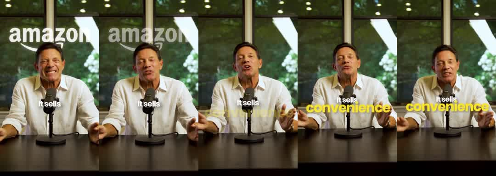

# v07_s08 · aroll_caption_big · 14.3–15.4s (calidad 4)

- **Guion:** It sells convenience.
- **Qué se ve:** 'It sells convenience.' — 'convenience' amarillo.
- **Diseño:** Fondo de estudio: mesa negra brillante, micrófono de podcast negro en primer plano centrado, ventanal con columnas y vegetación verde desenfocada detrás (no croma). Subtítulos centrados sobre el pecho/micrófono.
- **Efectos:** Grade cálido-verdoso natural, piel cálida, negros profundos en la mesa; bajo el A-roll queda a veces una franja negra inferior (≈5–9 % del alto) cuando el plano está más abierto (observed 3.7, 37.5); sin grano ni viñeta añadida.
- **Animación:** Amarillo entra ≈14.7.
- **Por qué aquí:** Beneficio en amarillo.
