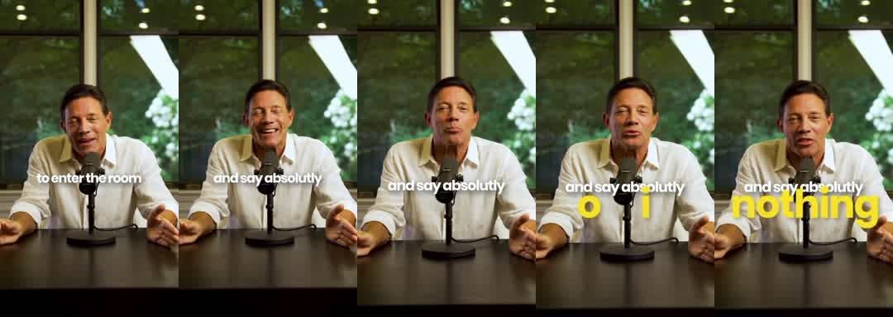

# v07_s10 · aroll_caption_big · 18.5–20.5s (calidad 5)

- **Guion:** and say absolutely nothing.
- **Qué se ve:** 'and say absolutely nothing.' — 'nothing' amarillo revelado letra a letra.
- **Diseño:** Fondo de estudio: mesa negra brillante, micrófono de podcast negro en primer plano centrado, ventanal con columnas y vegetación verde desenfocada detrás (no croma). Subtítulos centrados sobre el pecho/micrófono.
- **Efectos:** Grade cálido-verdoso natural, piel cálida, negros profundos en la mesa; bajo el A-roll queda a veces una franja negra inferior (≈5–9 % del alto) cuando el plano está más abierto (observed 3.7, 37.5); sin grano ni viñeta añadida.
- **Animación:** Letras de 'nothing' aparecen en orden aleatorio 19.87→20.33 (≈0.45 s) a 'nothing' 19.92.
- **Por qué aquí:** Remate irónico: la palabra 'nada' se construye pieza a pieza.
