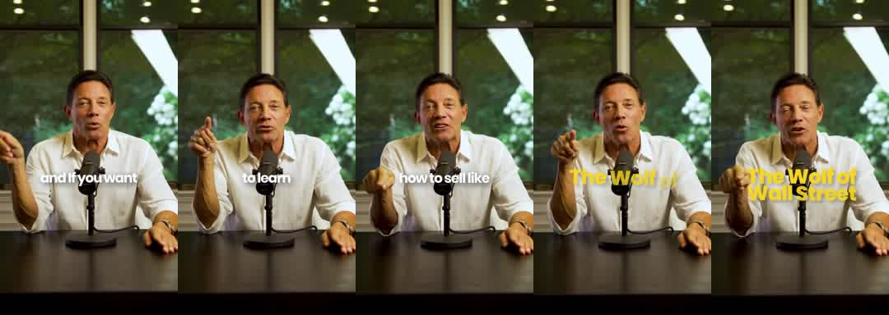

# v07_s24 · aroll_caption_big · 48.9–51.4s (calidad 4)

- **Guion:** And if you wanna learn how to sell like the Wolf of Wall Street,
- **Qué se ve:** 'And if you wanna learn how to sell like the Wolf of Wall Street,' — 'The Wolf of Wall Street' amarillo en dos líneas.
- **Diseño:** Fondo de estudio: mesa negra brillante, micrófono de podcast negro en primer plano centrado, ventanal con columnas y vegetación verde desenfocada detrás (no croma). Subtítulos centrados sobre el pecho/micrófono.
- **Efectos:** Grade cálido-verdoso natural, piel cálida, negros profundos en la mesa; bajo el A-roll queda a veces una franja negra inferior (≈5–9 % del alto) cuando el plano está más abierto (observed 3.7, 37.5); sin grano ni viñeta añadida.
- **Animación:** Corte 48.84; título amarillo ≈50.6.
- **Por qué aquí:** Marca personal en amarillo antes del CTA.
