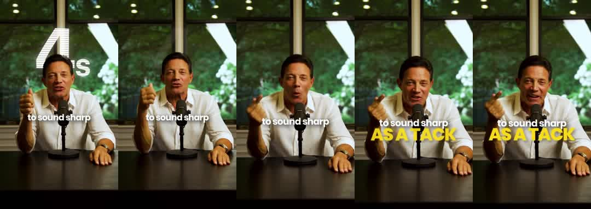

# v09_s04 · aroll_caption_big · 5.4–6.8s (calidad 4)

- **Guion:** to sound sharp as a tack,
- **Qué se ve:** 'to sound sharp' + 'AS A TACK' amarillo.
- **Diseño:** Estudio: mesa negra brillante, micrófono de podcast centrado, ventanal con vegetación detrás (no croma). Subtítulos centrados sobre el pecho.
- **Efectos:** Grade cálido-verdoso natural; franja negra inferior en algunos encuadres; sin grano ni viñeta añadida.
- **Animación:** Amarillo entra ≈6.3 ('tack' 6.56).
- **Por qué aquí:** Primera de las 3 cualidades: la metáfora va en amarillo.
