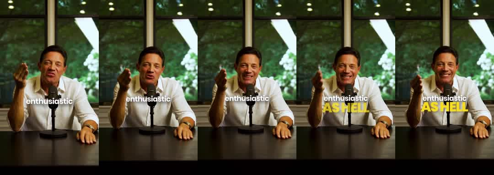

# v09_s05 · aroll_caption_big · 7.0–8.3s (calidad 4)

- **Guion:** enthusiastic as hell,
- **Qué se ve:** 'enthusiastic' + 'AS HELL' amarillo.
- **Diseño:** Estudio: mesa negra brillante, micrófono de podcast centrado, ventanal con vegetación detrás (no croma). Subtítulos centrados sobre el pecho.
- **Efectos:** Grade cálido-verdoso natural; franja negra inferior en algunos encuadres; sin grano ni viñeta añadida.
- **Animación:** Corte 6.92; amarillo ≈8.0 ('hell' 8.04).
- **Por qué aquí:** Segunda cualidad; énfasis coloquial.
