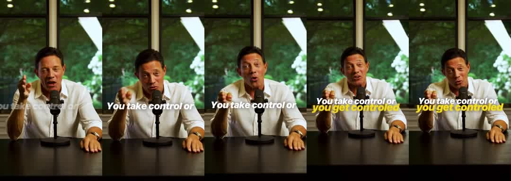

# v09_s09 · aroll_caption_big · 13.4–15.8s (calidad 5)

- **Guion:** You take control, or you get control.
- **Qué se ve:** 'You take control or' blanco ITÁLICA grande + 'you get controled' amarillo itálica minúscula.
- **Diseño:** Estudio: mesa negra brillante, micrófono de podcast centrado, ventanal con vegetación detrás (no croma). Subtítulos centrados sobre el pecho.
- **Efectos:** Grade cálido-verdoso natural; franja negra inferior en algunos encuadres; sin grano ni viñeta añadida.
- **Animación:** Corte 13.35; la línea blanca itálica entra deslizándose desde la izquierda (13.55→13.69); corte 14.60; amarillo blur-in 14.74→14.9.
- **Por qué aquí:** Dicotomía: el cambio a itálica marca la frase-lema.
