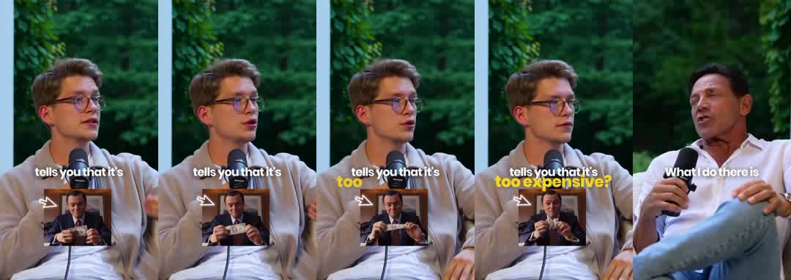

# v11_s02 · aroll_caption_big · 1.0–2.5s (calidad 4)

- **Guion:** tells you that it's too expensive?
- **Qué se ve:** [observado 1.5] Corte al entrevistador joven con gafas (jersey beige) en el mismo porche. Caption 'tells you that it's' blanco + segunda línea amarilla 'too expensive?' grande. El recuadro de película sigue abajo, ahora con DiCaprio rompiendo/contando billetes, y el cursor apuntando.
- **Diseño:** Línea 1 blanca ~3.5 % alto en y≈61 %; línea 2 amarilla #F5D21A aprox., mismo tipo extra-bold, ~1.5× más grande (~5 % alto), minúsculas, en y≈65 %. Recuadro igual que s01.
- **Efectos:** Sombra suave en texto; sin textura.
- **Animación:** [observado 1.03→1.37] 'too' aparece primero en amarillo y 'expensive?' se añade a ~1.8 (write-on por palabra). Cursor se queda estático sobre el recuadro.
- **Por qué aquí:** [inferido] La objeción 'too expensive' es el tema del video: va en amarillo grande para fijar el problema en el hook.
