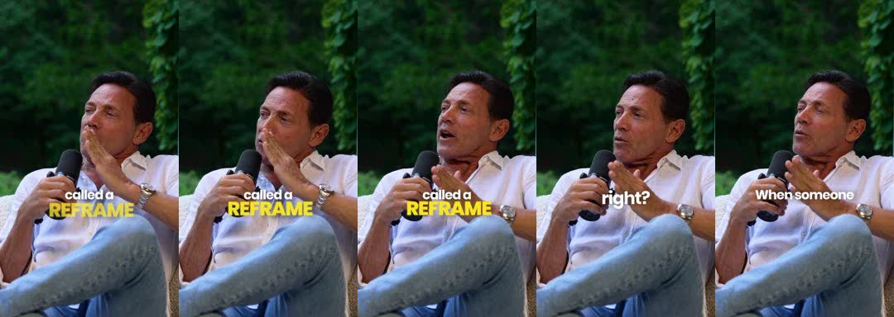

# v11_s04 · aroll_caption_big · 4.3–5.5s (calidad 4)

- **Guion:** reframe, right?
- **Qué se ve:** [observado 4.4] Jordan con la mano en la boca; caption 'called a' blanco + 'REFRAME' amarillo grande en mayúsculas. Luego 'right?' blanco (4.5–5.4).
- **Diseño:** Línea 1 blanca ~3.5 % alto; 'REFRAME' MAYÚSCULAS amarillo #F5D21A aprox., ~5 % alto, ~40 % del ancho, centro y≈65 %.
- **Efectos:** Sombra suave.
- **Animación:** [observado 4.23–4.30] 'REFRAME' entra con fade+blur de 2 fr (aparece translúcido y luego sólido), 0.05 s antes de la palabra.
- **Por qué aquí:** [inferido] Nombre de la técnica = palabra-concepto → mayúsculas amarillas para que se recuerde.
