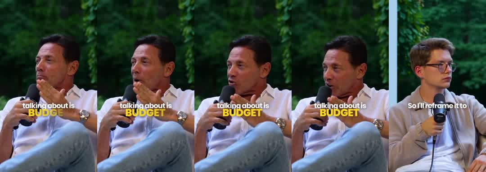

# v11_s06 · aroll_caption_big · 8.7–9.4s (calidad 4)

- **Guion:** budget.
- **Qué se ve:** [observado 8.6–9.3] 'talking about is' blanco + 'BUDGET' amarillo grande mayúsculas.
- **Diseño:** Igual que REFRAME: MAYÚSCULAS amarillas ~5 % alto bajo línea blanca.
- **Efectos:** Sombra suave.
- **Animación:** [observado] aparece en la palabra 'budget' (≈8.6), pop seco.
- **Por qué aquí:** [inferido] Revelación del reencuadre (caro = presupuesto): la palabra-clave se convierte en titular.
