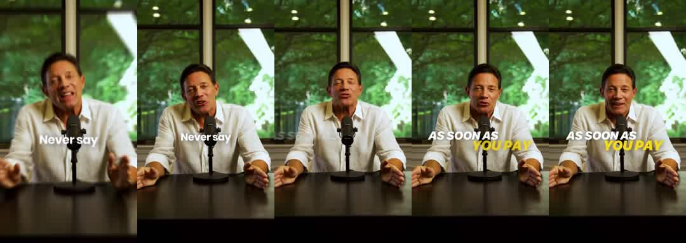

# v12_s01 · aroll_caption_big · 0.0–2.2s (calidad 4)

- **Guion:** Never say as soon as you pay
- **Qué se ve:** [observado 0.0–2.0] Jordan sentado de frente en mesa negra con micro de estudio sobre pie, camisa blanca de lino, detrás ventanal con árboles verdes y focos en el techo. Caption 'Never say' → 'AS SOON AS' + 'YOU PAY'.
- **Diseño:** 'Never say' blanco extra-bold minúsculas ~3 % alto, centro y≈56 %. 'AS SOON AS' blanco MAYÚSCULAS ITÁLICA extra-bold (~3 % alto) alineado a la izquierda del bloque; 'YOU PAY' amarillo #F6D117 aprox. MAYÚSCULAS ITÁLICA ~4 % alto, desplazado a la derecha debajo (y≈58–61 %). Bloque escalonado en diagonal.
- **Efectos:** Grado cálido/verde saturado, piel cálida; sin grano. Sombra suave bajo el texto.
- **Animación:** [observado 0.0–0.2] arranca con el A-roll escalado ~1.25× y salta a 1.0 en ~0.2 s (zoom-out de golpe = hook). [observado 1.2] 'AS SOON AS' aparece en su palabra; 'YOU PAY' a ~1.6 (write-on por línea).
- **Por qué aquí:** [inferido] Hook de 'never say X': el mensaje prohibido se escribe en mayúsculas/itálica para que se lea como cita a evitar.
