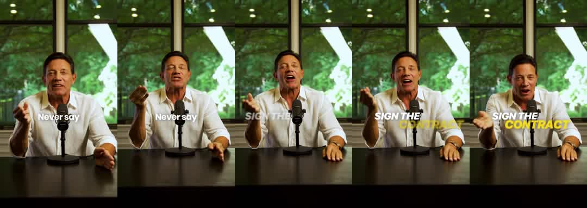

# v12_s05 · aroll_caption_big · 11.1–13.2s (calidad 4)

- **Guion:** never say sign the contract
- **Qué se ve:** [observado 11.2–13.0] 'Never say' → 'SIGN THE' + 'CONTRACT' amarillo itálica.
- **Diseño:** 2 niveles itálica MAYÚSCULAS escalonados (blanco a la izquierda, amarillo a la derecha). Bloque a y≈55–61 %.
- **Efectos:** Ninguno.
- **Animación:** [observado 11.23] jump-cut de escala (más abierto). 'SIGN THE' entra con blur-in 2 fr; 'CONTRACT' a ~12.8.
- **Por qué aquí:** [inferido] 2º 'never say': mismo formato itálico = sistema reconocible de frases prohibidas.
