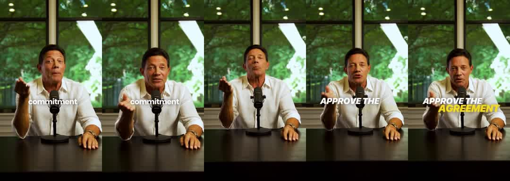

# v12_s07 · aroll_caption_big · 16.4–19.2s (calidad 4)

- **Guion:** commitment say approve the agreement
- **Qué se ve:** [observado 16.5–18.8] 'commitment' → 'Say' → 'APPROVE THE' + 'AGREEMENT' amarillo itálica.
- **Diseño:** 2 niveles itálica MAYÚSCULAS escalonados.
- **Efectos:** Ninguno.
- **Animación:** [observado 16.52] jump-cut de escala (más cerrado). 'AGREEMENT' entra con blur ~2 fr a ~18.7.
- **Por qué aquí:** [inferido] Alternativa positiva = mismo formato que la frase 'Say ...'.
