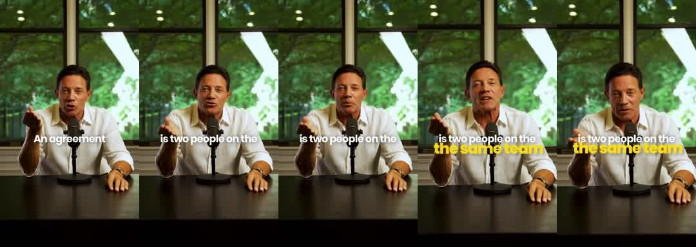

# v12_s08 · aroll_caption_big · 19.2–22.1s (calidad 3)

- **Guion:** an agreement is two people on the same team
- **Qué se ve:** [observado 19.5–21.6] 'An agreement' / 'is two people on the' + 'the same team' amarillo minúsculas grande.
- **Diseño:** Línea blanca minúsculas ~3 % + línea amarilla minúsculas no itálica ~4.5 % alto, ~70 % ancho.
- **Efectos:** Ninguno.
- **Animación:** [observado ~21.2] línea amarilla entra con fade en 'same'.
- **Por qué aquí:** [inferido] Definición/beneficio emocional (mismo equipo) → amarillo.
