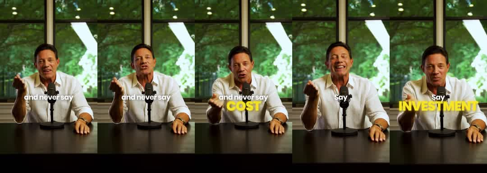

# v12_s09 · aroll_caption_big · 22.1–25.4s (calidad 5)

- **Guion:** and never say cost say investment
- **Qué se ve:** [observado 22.5–24.9] 'and never say' + 'COST' amarillo; 'Say' + 'INVESTMENT' amarillo grande (~80 % ancho).
- **Diseño:** Blanco minúsculas ~3 % + amarillo MAYÚSCULAS ~5 % alto no itálica; INVESTMENT x≈10–91 %.
- **Efectos:** Ninguno.
- **Animación:** [observado 22.19] jump-cut de escala (más abierto). [observado 23.2 y 24.9–25.3] 'COST' e 'INVESTMENT' se revelan por letras sueltas en orden aleatorio ('C' → 'OST' → 'COST'; 'V T EN' → 'INVES  T' → 'INVESTMENT') en ~0.3 s.
- **Por qué aquí:** [inferido] Par de palabras a sustituir (cost→investment): la revelación de letras convierte la palabra en un 'código' a memorizar.
