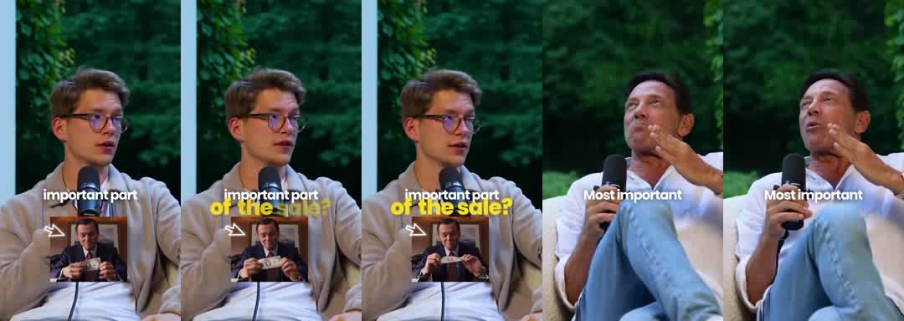

# v13_s02 · aroll_caption_big · 1.2–2.1s (calidad 3)

- **Guion:** for the sale?
- **Qué se ve:** [observado 1.6–1.9] entrevistador; 'important part' blanco + 'of the sale?' amarillo grande; recuadro y cursor siguen.
- **Diseño:** Blanco ~3 % + amarillo ≈#F2CB1D minúsculas ~4.5 % alto, y≈65 %.
- **Efectos:** Ninguno.
- **Animación:** Línea amarilla entra con fade ~2 fr.
- **Por qué aquí:** [inferido] La pregunta-tema ('the sale') se fija en amarillo en el hook.
