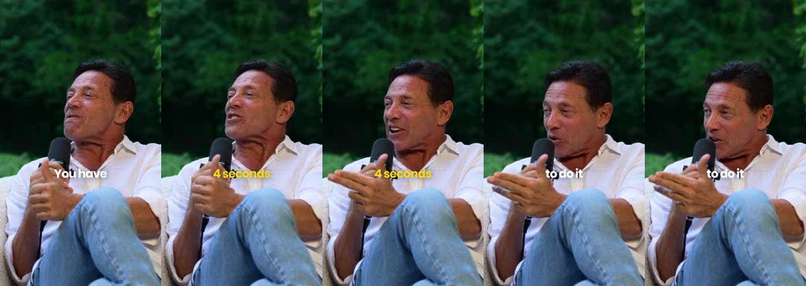

# v13_s06 · aroll_caption_big · 9.4–10.7s (calidad 3)

- **Guion:** four seconds to do it.
- **Qué se ve:** [observado 9.0–10.0] '4 seconds' en amarillo (número en cifra) y luego 'to do it' blanco.
- **Diseño:** Línea única amarilla al tamaño base (~3 %); el número se escribe '4'.
- **Efectos:** Ninguno.
- **Animación:** [observado 9.53] sustitución seca 'You have' → '4 seconds' amarillo.
- **Por qué aquí:** [inferido] Dato numérico → cifra + amarillo.
