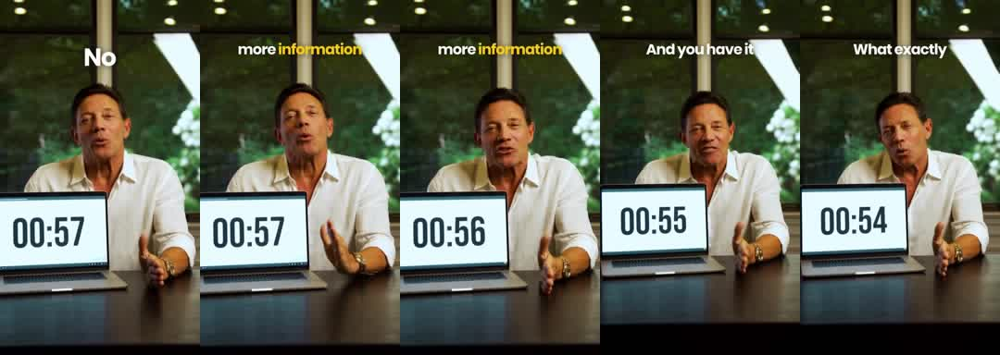

# v14_s04 · aroll_caption_big · 3.3–6.0s (calidad 3)

- **Guion:** No, you need more information and you have it now.
- **Qué se ve:** [observado 3.2–5.6] 'No' / 'you need' / 'more information' ('information' amarillo inline) / 'And you have it' + 'NOW' amarillo MAYÚSCULAS.
- **Diseño:** Subtítulo ARRIBA (y≈12–14 %), blanco extra-bold minúsculas ~2.5 % alto; 'NOW' amarillo MAYÚSCULAS ~4 % alto debajo.
- **Efectos:** Ninguno.
- **Animación:** [observado 4.96] jump-cut de escala. 'NOW' entra con fade ~5.2.
- **Por qué aquí:** [inferido] Respuesta a la objeción; 'now' = cierre inmediato.
