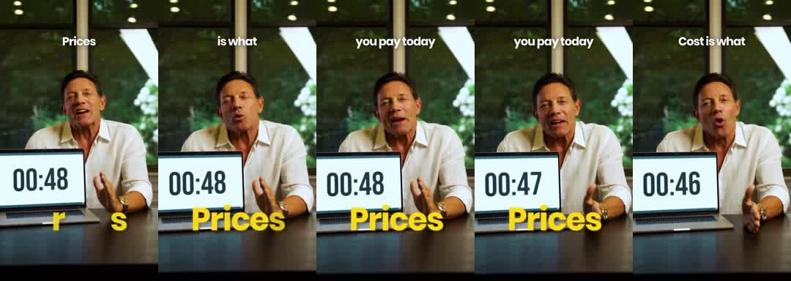

# v14_s08 · aroll_caption_big · 10.5–12.2s (calidad 5)

- **Guion:** Price is what you pay today.
- **Qué se ve:** [observado 10.5–11.8] 'Prices' amarillo gigante abajo sobre el portátil; arriba 'is what' / 'you pay today'.
- **Diseño:** 'Prices' amarillo #FAD012 aprox. bold minúsculas (capital inicial) ~7 % alto, ~45 % ancho, centro x≈45 %, y≈78 %. Línea blanca arriba ~2.5 %.
- **Efectos:** Ninguno.
- **Animación:** [observado 10.7–11.0] 'Prices' se revela por letras sueltas en orden aleatorio ('i' → 's r s' → 'P i es' → 'Prices') ~0.3 s.
- **Por qué aquí:** [inferido] Concepto a contrastar (price vs cost) en grande abajo, el subtítulo sigue arriba.
