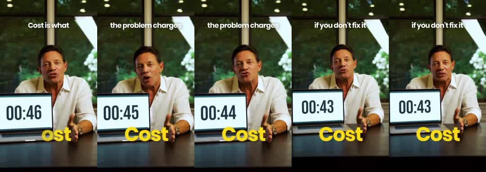

# v14_s09 · aroll_caption_big · 12.2–15.9s (calidad 4)

- **Guion:** Cost is what the problem charges you every month. You don't fix it.
- **Qué se ve:** [observado 12.0–15.6] 'Cost' amarillo grande abajo (sustituye a 'Prices'); arriba 'Cost is what' / 'the problem charges' / 'you every month' / 'if you don't fix it'.
- **Diseño:** Igual que s08; 'Cost' ~7 % alto, x≈30–60 %.
- **Efectos:** Ninguno.
- **Animación:** 'Cost' entra con revelado de letras ~12.3; permanece 3.4 s.
- **Por qué aquí:** [inferido] Contraste price/cost: la palabra grande se mantiene mientras se explica.
