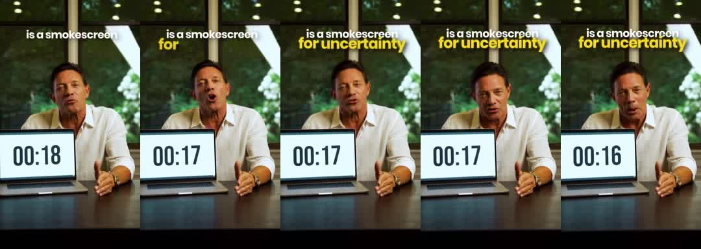

# v14_s21 · aroll_caption_big · 35.6–37.1s (calidad 3)

- **Guion:** for uncertainty.
- **Qué se ve:** [observado 35.6–36.9] 'is a smokescreen' + 'for uncertainty' amarillo grande.
- **Diseño:** Amarillo minúsculas ~4 % alto, ~75 % ancho, y≈16–19 %.
- **Efectos:** Ninguno.
- **Animación:** [observado 35.6–36.0] write-on 'for' → 'for uncertainty'.
- **Por qué aquí:** [inferido] Concepto clave de Belfort (certeza/incertidumbre).
