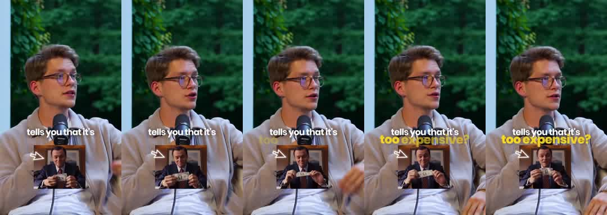

# v17_s02 · aroll_caption_big · 1.0–2.2s (calidad 5)

- **Guion:** tells you that it's too expensive?
- **Qué se ve:** [observed 1.0–2.33] Corte al entrevistador joven (gafas, chaqueta beige, micrófono) escuchando; misma foto+cursor abajo. Subtítulo de 2 niveles: 'tells you that it's' blanco pequeño + 'too expensive?' AMARILLO grande.
- **Diseño:** Línea 1 blanca ≈3 % alto; línea 2 amarilla #F3D33B aprox., ≈4.5 % alto (≈1.5×), minúsculas, bold, pegada debajo (y≈64 %).
- **Efectos:** Sombra suave bajo el texto.
- **Animación:** [observed 1.5–1.8] La línea amarilla se escribe por letras/sílabas: 'too' (1.63) → 'too exp' → 'too expensive?' (≈1.85), write-on tipo máquina de escribir ≈0.25 s.
- **Por qué aquí:** [inferred] La objeción literal en amarillo = la palabra que el público reconoce; plano del oyente = 'pregunta del cliente'.
