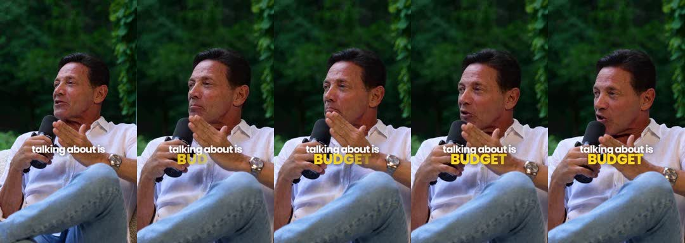

# v17_s05 · aroll_caption_big · 8.4–9.1s (calidad 5)

- **Guion:** is a budget.
- **Qué se ve:** [observed 8.44–9.3] Jump cut/punch leve a 8.44; 'talking about is' blanco + 'BUDGET' AMARILLO MAYÚSCULAS debajo.
- **Diseño:** 'BUDGET' bold mayúsculas amarillo ≈4.5–5 % alto, centrado bajo la línea blanca (y≈65 %).
- **Efectos:** Sombra suave.
- **Animación:** [observed 8.50–8.77] write-on por letras B→BU→BUD→BUDG→BUDGE→BUDGET (≈1 letra/2 fr, ≈0.3 s).
- **Por qué aquí:** [inferred] Palabra-concepto del reframe (precio = presupuesto) → mayúsculas amarillas.
