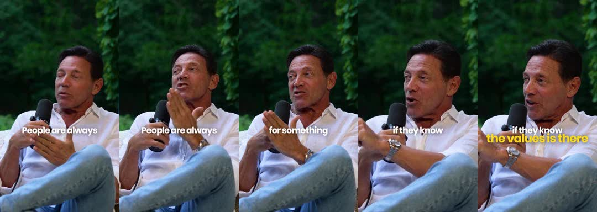

# v17_s17 · aroll_caption_big · 33.2–37.2s (calidad 3)

- **Guion:** People are always willing to pay for something if they know the value is there.
- **Qué se ve:** [observed 33.23–37.3] Jordan, jump cut a 35.87 ('if they know'); termina con 'if they know' blanco + 'the values is there' AMARILLO grande.
- **Diseño:** Línea amarilla ≈4.5 % alto bajo la blanca.
- **Efectos:** Ninguno.
- **Animación:** Corte seco 33.23 y jump cut 35.87; línea amarilla aparece al final de la frase (≈36.5).
- **Por qué aquí:** [inferred] La regla general en amarillo = frase para recordar.
