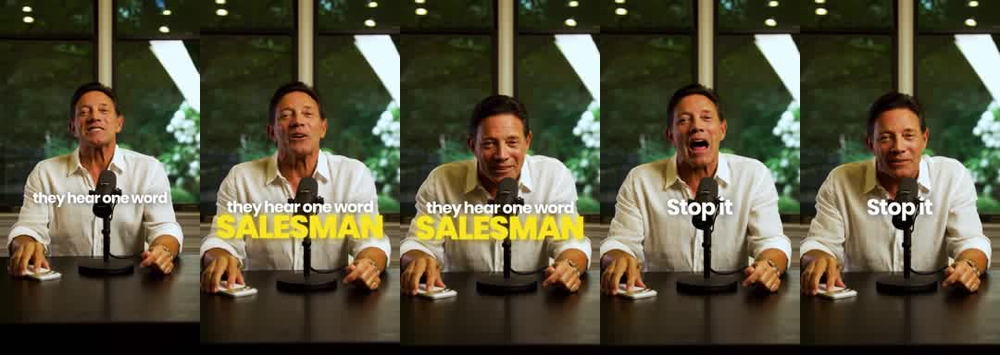

# v18_s04 · aroll_caption_big · 8.4–11.0s (calidad 5)

- **Guion:** salesman. Stop it.
- **Qué se ve:** [observed 8.63–10.0] 'they hear one word' blanco + 'SALESMAN' amarillo mayúsculas que ocupa ≈83 % del ancho; push-in lento; luego 'Stop it'.
- **Diseño:** 'SALESMAN' bold mayúsculas amarillo ≈5.5 % alto, y≈64 %; blanco encima ≈2.5 %.
- **Efectos:** Sombra suave.
- **Animación:** [observed] write-on por letras desordenado ('AL S'→'SAL SMAN'→'SALESMAN') 8.63–8.91; push-in lento 9.2→9.8 (≈1.0→1.1).
- **Por qué aquí:** [inferred] La palabra que el cliente 'oye' = la etiqueta negativa, en mayúsculas.
