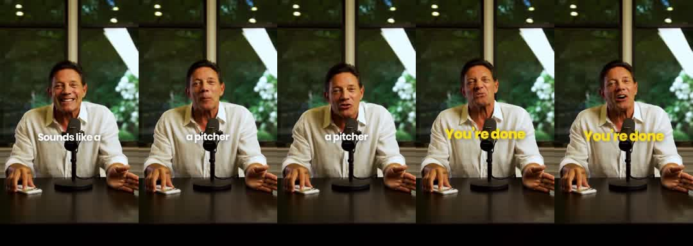

# v18_s19 · aroll_caption_big · 45.6–47.6s (calidad 3)

- **Guion:** Sound like a pitcher, you're done.
- **Qué se ve:** [observed 45.52] Zoom-out por corte; 'Sounds like a', 'a pitcher', 'You're done' amarillo.
- **Diseño:** Amarillo una línea ≈4 % alto.
- **Efectos:** Igual.
- **Animación:** [observed] 'You're done' aparece con write-on por letras 46.95→47.1.
- **Por qué aquí:** [inferred] Veredicto negativo en amarillo.
