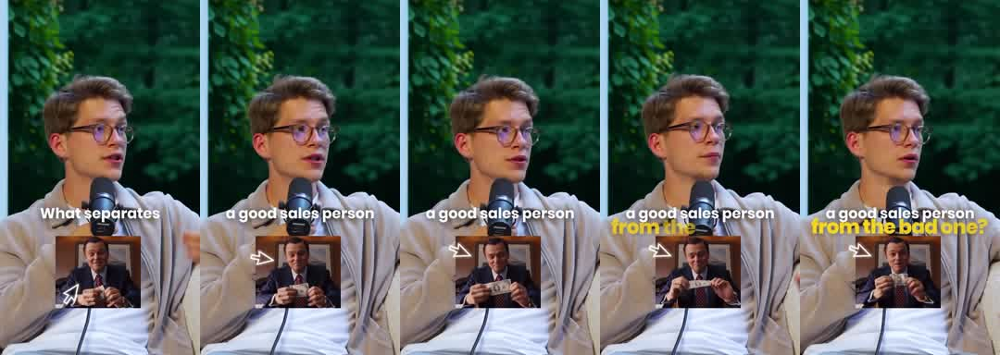

# v19_s02 · aroll_caption_big · 0.6–2.2s (calidad 4)

- **Guion:** a good salesperson from the bad one?
- **Qué se ve:** [observed 0.67–2.37] Corte al entrevistador; foto+cursor siguen; 'a good sales person' blanco + 'from the bad one?' amarillo grande.
- **Diseño:** Amarillo ≈#F3D33B ≈4.5 % alto bajo la línea blanca (y≈64 %).
- **Efectos:** Sombra suave.
- **Animación:** [observed] 'from the bad one?' write-on por letras 1.6→2.1.
- **Por qué aquí:** [inferred] Pregunta-hook en voz del oyente; el contraste 'bad' en amarillo.
