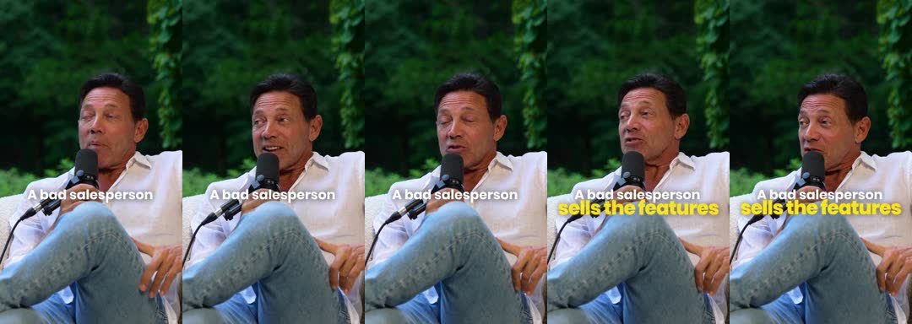

# v19_s04 · aroll_caption_big · 3.6–5.8s (calidad 4)

- **Guion:** A bad salesperson sells the features
- **Qué se ve:** [observed 3.0–5.8] 'A bad salesperson' blanco + 'sells the features' amarillo debajo.
- **Diseño:** 2 niveles, amarillo ≈4.5 % alto.
- **Efectos:** Ninguno.
- **Animación:** [observed] amarillo write-on por letras 5.0→5.1 (con 'sells' 4.80).
- **Por qué aquí:** [inferred] Primera mitad del contraste features/benefits.
