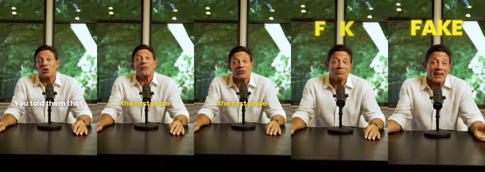

# v20_s13 · aroll_caption_big · 32.7–35.6s (calidad 5)

- **Guion:** You told them that the first price you offered was fake.
- **Qué se ve:** [observed 33.0–35.9] 'the first price' amarillo inline; en 'fake' zoom-out por corte (34.93) y 'FAKE' gigante amarillo mayúsculas ARRIBA (y≈8–15 %), sustituyendo al subtítulo.
- **Diseño:** 'FAKE' ≈8 % alto, ≈55 % ancho, centrado arriba.
- **Efectos:** Ninguno.
- **Animación:** [observed] 'FAKE' write-on por letras 34.93→35.1; desaparece con fade 35.77.
- **Por qué aquí:** [inferred] Palabra-veredicto aislada y gigante.
