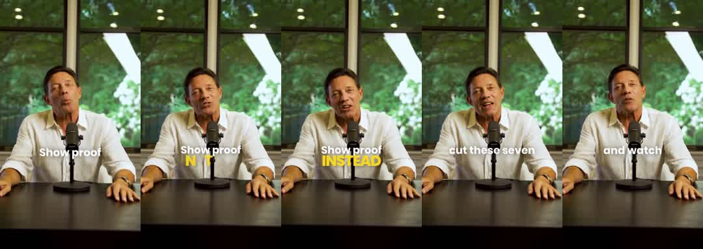

# v20_s20 · aroll_caption_big · 52.2–54.7s (calidad 3)

- **Guion:** Show proof instead. Cut these seven and
- **Qué se ve:** [observed 52.14–54.8] Reencuadre 52.14; 'Show proof' + 'INSTEAD' amarillo (write-on 52.73–53.23); 'and watch'.
- **Diseño:** 2 niveles.
- **Efectos:** Ninguno.
- **Animación:** [observed] write-on por letras desordenado ('I  E', 'TEAD', 'IN TEAD', 'INSTEAD').
- **Por qué aquí:** [inferred] Solución.
