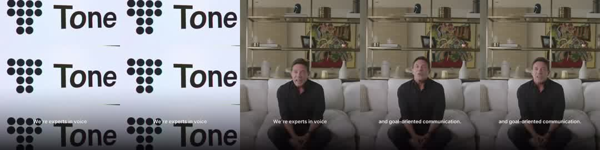

# v03_s05 · aroll_punch · 11.7–14.9s (calidad 2)

- **Guion:** We're experts in voice and goal -oriented communication.
- **Qué se ve:** Corte (12.64) a primer plano de perfil 3/4 muy cerrado; corte (13.35) a plano medio frontal del sofá. (observado 12.6–14.9)
- **Diseño:** Subtítulo blanco pequeño a ~81 %.
- **Efectos:** Grado cinematográfico, fondo desenfocado.
- **Animación:** Cortes secos 12.64 y 13.35 (cambio de cámara A/B).
- **Por qué aquí:** Alternar cámaras mantiene ritmo de entrevista (inferido).
